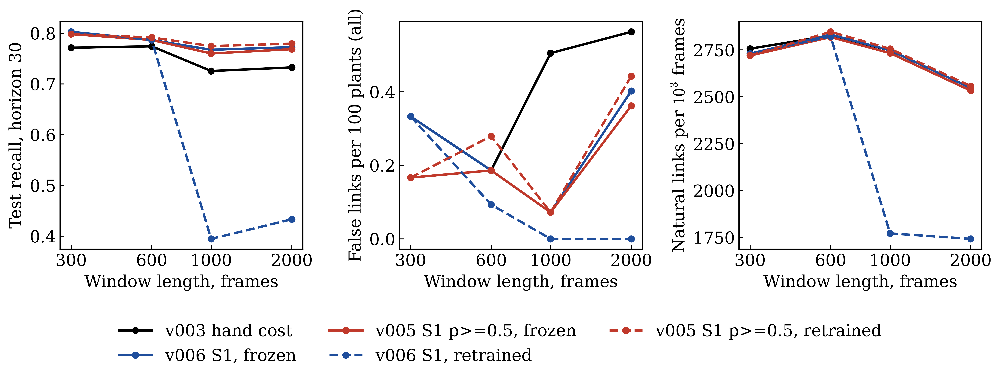
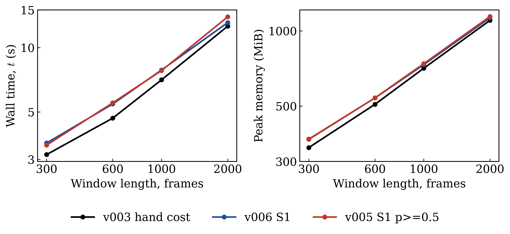
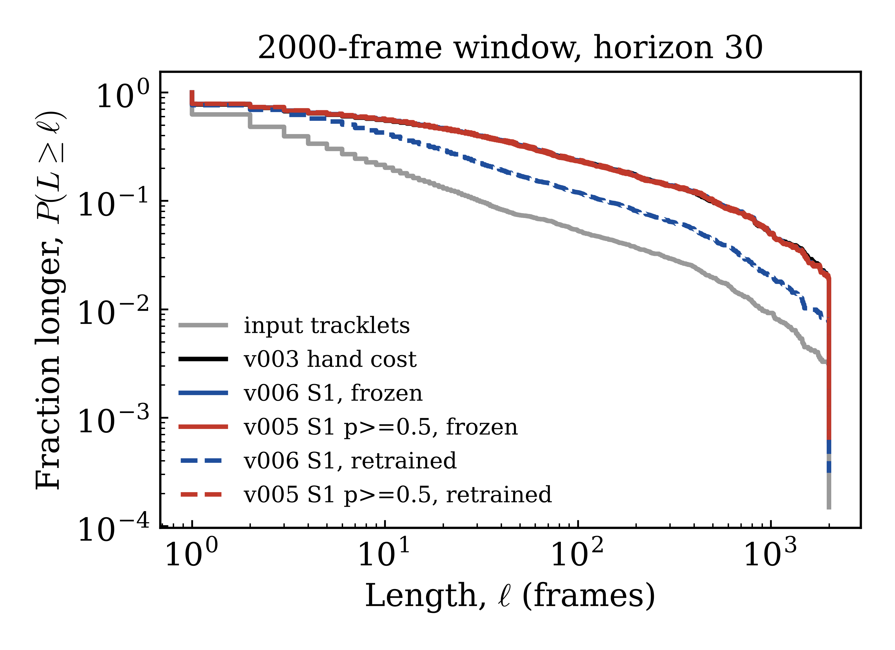

# Gap bridging v007: scaling to the 2,000-frame demo (generated tables)

Generated by `scripts/gap_scaling.py report` from `logs/gap_scaling_v007/` (Slurm chain `jobs/gap_scaling_v007_submit.sh`); the method, caveats and the verdict are in [GAP_BRIDGING.md](GAP_BRIDGING.md#v007-scaling-to-the-2000-frame-demo). Variants: the v003 hand cost; v006 S1 at its pipeline threshold and v005 S1 at p >= 0.5 (dummy tied), each as committed (frozen, trained on the 300-frame demo) and retrained on the window's own hand-cost sweeps (5 seeds, short profile).

## Windows

| frames | original frames | rows | tracklets | plants per gap (density target) | decoys | flicker | plants incl. decoy targets (all, 5 seeds) | of which test fold |
|---:|---|---:|---:|---:|---:|---:|---:|---:|
| 300 | 14250-14549 | 36573 | 1181 | 8 (8) | 4 | 2 | 600 | 223 |
| 600 | 14100-14699 | 73000 | 2306 | 15 (16) | 7 | 3 | 1074 | 403 |
| 1000 | 13900-14899 | 120872 | 3647 | 19 (27) | 9 | 4 | 1385 | 550 |
| 2000 | 13410-15409 | 243588 | 6718 | 34 (53) | 17 | 8 | 2485 | 1002 |

## Retrained S1 per window (pipeline rule)

| frames | train pairs (positive) | test pairs (positive) | rule threshold | pair threshold | train-fold plants through gap 30 (recovered / false) | pairwise test precision | pairwise test recall |
|---:|---:|---:|---:|---:|---|---:|---:|
| 300 | 1368 (510) | 537 (287) | 0.413 | 0.989 | 289 / 0 of 300 | 0.965 | 0.972 |
| 600 | 2697 (822) | 1184 (529) | 0.706 | 0.992 | 533 / 0 of 551 | 0.977 | 0.947 |
| 1000 | 3673 (1078) | 1587 (681) | 0.99 | 0.995 | 320 / 0 of 681 | 0.993 | 0.423 |
| 2000 | 6558 (1903) | 3076 (1324) | 0.99 | 0.99 | 681 / 0 of 1222 | 1 | 0.477 |

## Promotion rule per window (test fold, horizon 30, through gap 30; floor = hand-cost natural links on that window)

The rule is applied at horizon 30 on every window. `compare` itself checks at the hand cost's chosen horizon (largest horizon whose pooled precision is 1.0 at every planted gap, else the fallback 30), which moves between windows; its chosen horizons and verdicts are in the last two columns.

| frames | variant | verdict | precision 1.0 | recall >= hand | natural links | failing | own chosen horizon | compare's verdict |
|---:|---|---|---|---|---|---|---|---|
| 300 | v003 hand cost | pass | yes | yes | 827 (floor 827) | - | none | pass at 30 |
| 300 | v006 S1, frozen | fail | yes | yes | 819 (floor 827) | demo:links | none | fail at 30 |
| 300 | v005 S1 p>=0.5, frozen | fail | yes | no | 816 (floor 827) | 2:recall demo:links | none | fail at 30 |
| 300 | v006 S1, retrained | fail | yes | yes | 819 (floor 827) | demo:links | none | fail at 30 |
| 300 | v005 S1 p>=0.5, retrained | fail | yes | no | 816 (floor 827) | 2:recall demo:links | none | fail at 30 |
| 600 | v003 hand cost | fail | no | yes | 1696 (floor 1696) | 5:precision 30:precision | 10 | pass at 10 |
| 600 | v006 S1, frozen | fail | no | no | 1699 (floor 1696) | 10:recall 20:recall 30:precision | 15 | fail at 10 |
| 600 | v005 S1 p>=0.5, frozen | fail | no | no | 1691 (floor 1696) | 10:recall 20:recall 30:precision demo:links | 15 | fail at 10 |
| 600 | v006 S1, retrained | fail | no | no | 1693 (floor 1696) | 1:recall 10:recall 20:recall 30:precision demo:links | 15 | fail at 10 |
| 600 | v005 S1 p>=0.5, retrained | fail | no | no | 1708 (floor 1696) | 1:recall 10:recall 20:recall 30:precision | 15 | fail at 10 |
| 1000 | v003 hand cost | fail | no | yes | 2748 (floor 2748) | 3:precision 30:precision | none | fail at 30 |
| 1000 | v006 S1, frozen | fail | yes | no | 2748 (floor 2748) | 2:recall | 60 | fail at 30 |
| 1000 | v005 S1 p>=0.5, frozen | fail | yes | no | 2733 (floor 2748) | 2:recall demo:links | 60 | fail at 30 |
| 1000 | v006 S1, retrained | fail | yes | no | 1771 (floor 2748) | 1:recall 2:recall 3:recall 5:recall 10:recall 15:recall 20:recall 30:recall demo:links | 60 | fail at 30 |
| 1000 | v005 S1 p>=0.5, retrained | fail | yes | no | 2756 (floor 2748) | 5:recall | 60 | fail at 30 |
| 2000 | v003 hand cost | fail | no | yes | 5095 (floor 5095) | 10:precision 15:precision 20:precision 30:precision | 5 | pass at 5 |
| 2000 | v006 S1, frozen | fail | no | no | 5095 (floor 5095) | 1:recall 2:recall 10:precision 10:recall 15:precision 20:precision | none | fail at 5 |
| 2000 | v005 S1 p>=0.5, frozen | fail | no | no | 5066 (floor 5095) | 1:recall 2:recall 10:precision 10:recall 15:precision 20:precision demo:links | none | fail at 5 |
| 2000 | v006 S1, retrained | fail | yes | no | 3484 (floor 5095) | 1:recall 2:recall 3:recall 5:recall 10:recall 15:recall 20:recall 30:recall demo:links | 60 | fail at 5 |
| 2000 | v005 S1 p>=0.5, retrained | fail | no | no | 5114 (floor 5095) | 1:recall 5:recall 10:precision 10:recall 15:precision 20:precision | none | fail at 5 |

## Plants only (decoy targets excluded), horizon 30, gaps 1-30

Decoy targets are planted pairs with a donor right half placed 3 px from the true right half; with 1-frame halves no linker can tell them apart. Recall >= hand is per gap against the hand cost on the same plants.

| fold | frames | variant | recovered / false of planted | gaps with a false link | precision 1.0 | recall >= hand |
|---|---:|---|---|---|---|---|
| test | 300 | v003 hand cost | 115 / 0 of 119 | - | yes | yes |
| test | 300 | v006 S1, frozen | 118 / 0 of 119 | - | yes | yes |
| test | 300 | v005 S1 p>=0.5, frozen | 117 / 0 of 119 | - | yes | no |
| test | 300 | v006 S1, retrained | 118 / 0 of 119 | - | yes | yes |
| test | 300 | v005 S1 p>=0.5, retrained | 117 / 0 of 119 | - | yes | no |
| test | 600 | v003 hand cost | 207 / 0 of 216 | - | yes | yes |
| test | 600 | v006 S1, frozen | 210 / 1 of 216 | 30 | no | no |
| test | 600 | v005 S1 p>=0.5, frozen | 210 / 1 of 216 | 30 | no | no |
| test | 600 | v006 S1, retrained | 210 / 1 of 216 | 30 | no | no |
| test | 600 | v005 S1 p>=0.5, retrained | 210 / 1 of 216 | 30 | no | no |
| test | 1000 | v003 hand cost | 272 / 1 of 297 | 3 | no | yes |
| test | 1000 | v006 S1, frozen | 285 / 0 of 297 | - | yes | no |
| test | 1000 | v005 S1 p>=0.5, frozen | 281 / 0 of 297 | - | yes | no |
| test | 1000 | v006 S1, retrained | 138 / 0 of 297 | - | yes | no |
| test | 1000 | v005 S1 p>=0.5, retrained | 288 / 0 of 297 | - | yes | no |
| test | 2000 | v003 hand cost | 518 / 2 of 562 | 20 | no | yes |
| test | 2000 | v006 S1, frozen | 533 / 3 of 562 | 10 20 | no | no |
| test | 2000 | v005 S1 p>=0.5, frozen | 530 / 3 of 562 | 10 20 | no | no |
| test | 2000 | v006 S1, retrained | 314 / 0 of 562 | - | yes | no |
| test | 2000 | v005 S1 p>=0.5, retrained | 539 / 3 of 562 | 10 20 | no | no |
| all | 300 | v003 hand cost | 305 / 0 of 320 | - | yes | yes |
| all | 300 | v006 S1, frozen | 315 / 1 of 320 | 30 | no | yes |
| all | 300 | v005 S1 p>=0.5, frozen | 313 / 0 of 320 | - | yes | no |
| all | 300 | v006 S1, retrained | 315 / 1 of 320 | 30 | no | yes |
| all | 300 | v005 S1 p>=0.5, retrained | 313 / 0 of 320 | - | yes | no |
| all | 600 | v003 hand cost | 572 / 0 of 600 | - | yes | yes |
| all | 600 | v006 S1, frozen | 581 / 1 of 600 | 30 | no | no |
| all | 600 | v005 S1 p>=0.5, frozen | 579 / 1 of 600 | 30 | no | no |
| all | 600 | v006 S1, retrained | 586 / 1 of 600 | 30 | no | no |
| all | 600 | v005 S1 p>=0.5, retrained | 589 / 2 of 600 | 20 30 | no | no |
| all | 1000 | v003 hand cost | 707 / 4 of 760 | 3 10 20 | no | yes |
| all | 1000 | v006 S1, frozen | 729 / 1 of 760 | 30 | no | no |
| all | 1000 | v005 S1 p>=0.5, frozen | 724 / 1 of 760 | 30 | no | no |
| all | 1000 | v006 S1, retrained | 359 / 0 of 760 | - | yes | no |
| all | 1000 | v005 S1 p>=0.5, retrained | 744 / 1 of 760 | 30 | no | no |
| all | 2000 | v003 hand cost | 1275 / 4 of 1360 | 15 20 | no | yes |
| all | 2000 | v006 S1, frozen | 1302 / 7 of 1360 | 10 15 20 30 | no | no |
| all | 2000 | v005 S1 p>=0.5, frozen | 1296 / 6 of 1360 | 10 20 30 | no | no |
| all | 2000 | v006 S1, retrained | 781 / 0 of 1360 | - | yes | no |
| all | 2000 | v005 S1 p>=0.5, retrained | 1322 / 5 of 1360 | 10 20 30 | no | no |

## Hold-out at horizon 30, test fold (recovered / false links of planted, recall)

| frames | v003 hand cost | v006 S1, frozen | v005 S1 p>=0.5, frozen | v006 S1, retrained | v005 S1 p>=0.5, retrained |
|---:|---|---|---|---|---|
| 300 | 172 / 1 of 223 (77.1%) | 179 / 1 of 223 (80.3%) | 178 / 1 of 223 (79.8%) | 179 / 1 of 223 (80.3%) | 178 / 1 of 223 (79.8%) |
| 600 | 312 / 2 of 403 (77.4%) | 317 / 1 of 403 (78.7%) | 317 / 1 of 403 (78.7%) | 317 / 1 of 403 (78.7%) | 319 / 1 of 403 (79.2%) |
| 1000 | 399 / 3 of 550 (72.5%) | 422 / 0 of 550 (76.7%) | 418 / 0 of 550 (76.0%) | 217 / 0 of 550 (39.5%) | 426 / 0 of 550 (77.5%) |
| 2000 | 734 / 9 of 1002 (73.3%) | 774 / 5 of 1002 (77.2%) | 770 / 5 of 1002 (76.8%) | 434 / 0 of 1002 (43.3%) | 781 / 8 of 1002 (77.9%) |

## Hold-out at horizon 30, all plants (recovered / false links of planted, recall)

| frames | v003 hand cost | v006 S1, frozen | v005 S1 p>=0.5, frozen | v006 S1, retrained | v005 S1 p>=0.5, retrained |
|---:|---|---|---|---|---|
| 300 | 452 / 2 of 600 (75.3%) | 474 / 2 of 600 (79.0%) | 472 / 1 of 600 (78.7%) | 474 / 2 of 600 (79.0%) | 472 / 1 of 600 (78.7%) |
| 600 | 824 / 2 of 1074 (76.7%) | 852 / 2 of 1074 (79.3%) | 850 / 2 of 1074 (79.1%) | 856 / 1 of 1074 (79.7%) | 863 / 3 of 1074 (80.4%) |
| 1000 | 1031 / 7 of 1385 (74.4%) | 1077 / 1 of 1385 (77.8%) | 1070 / 1 of 1385 (77.3%) | 528 / 0 of 1385 (38.1%) | 1098 / 1 of 1385 (79.3%) |
| 2000 | 1859 / 14 of 2485 (74.8%) | 1954 / 10 of 2485 (78.6%) | 1943 / 9 of 2485 (78.2%) | 1114 / 0 of 2485 (44.8%) | 1983 / 11 of 2485 (79.8%) |

## Hold-out at horizon 60, all plants (recovered / false links of planted, recall)

| frames | v003 hand cost | v006 S1, frozen | v005 S1 p>=0.5, frozen | v006 S1, retrained | v005 S1 p>=0.5, retrained |
|---:|---|---|---|---|---|
| 300 | 497 / 2 of 600 (82.8%) | 585 / 2 of 600 (97.5%) | 582 / 1 of 600 (97.0%) | 585 / 2 of 600 (97.5%) | 582 / 1 of 600 (97.0%) |
| 600 | 887 / 2 of 1074 (82.6%) | 1022 / 3 of 1074 (95.2%) | 1019 / 3 of 1074 (94.9%) | 1023 / 3 of 1074 (95.3%) | 1035 / 5 of 1074 (96.4%) |
| 1000 | 1123 / 8 of 1385 (81.1%) | 1317 / 1 of 1385 (95.1%) | 1310 / 1 of 1385 (94.6%) | 568 / 0 of 1385 (41.0%) | 1346 / 1 of 1385 (97.2%) |
| 2000 | 2011 / 17 of 2485 (80.9%) | 2327 / 14 of 2485 (93.6%) | 2314 / 13 of 2485 (93.1%) | 1256 / 0 of 2485 (50.5%) | 2381 / 15 of 2485 (95.8%) |

## Input tracklets per window

| frames | tracklets | median span | mean span | frame share in spans >= 150 | share spanning window |
|---:|---:|---:|---:|---:|---:|
| 300 | 1181 | 3 | 30.9 | 0.709 | 0.0525 |
| 600 | 2306 | 2 | 31.6 | 0.728 | 0.0208 |
| 1000 | 3647 | 2 | 33 | 0.777 | 0.0096 |
| 2000 | 6718 | 2 | 36.2 | 0.791 | 0.00313 |

## Natural links at horizon 30 (unplanted window)

| frames | variant | links | links per 1000 frames | trajectories | median length | mean length | frame share in trajectories >= 150 | share spanning window | identity starts |
|---:|---|---:|---:|---:|---:|---:|---:|---:|---:|
| 300 | v003 hand cost | 827 | 2757 | 354 | 51.5 | 113 | 0.81 | 0.218 | 231 |
| 300 | v006 S1, frozen | 819 | 2730 | 362 | 45 | 111 | 0.806 | 0.21 | 239 |
| 300 | v005 S1 p>=0.5, frozen | 816 | 2720 | 365 | 44 | 110 | 0.806 | 0.208 | 242 |
| 300 | v006 S1, retrained | 819 | 2730 | 362 | 45 | 111 | 0.806 | 0.21 | 239 |
| 300 | v005 S1 p>=0.5, retrained | 816 | 2720 | 365 | 44 | 110 | 0.806 | 0.208 | 242 |
| 600 | v003 hand cost | 1696 | 2827 | 610 | 24.5 | 132 | 0.848 | 0.103 | 494 |
| 600 | v006 S1, frozen | 1699 | 2832 | 607 | 25 | 133 | 0.843 | 0.102 | 491 |
| 600 | v005 S1 p>=0.5, frozen | 1691 | 2818 | 615 | 24 | 131 | 0.843 | 0.101 | 499 |
| 600 | v006 S1, retrained | 1693 | 2822 | 613 | 24 | 131 | 0.845 | 0.101 | 497 |
| 600 | v005 S1 p>=0.5, retrained | 1708 | 2847 | 598 | 25 | 135 | 0.848 | 0.104 | 482 |
| 1000 | v003 hand cost | 2748 | 2748 | 899 | 18 | 148 | 0.88 | 0.0578 | 785 |
| 1000 | v006 S1, frozen | 2748 | 2748 | 899 | 20 | 149 | 0.878 | 0.0556 | 785 |
| 1000 | v005 S1 p>=0.5, frozen | 2733 | 2733 | 914 | 19 | 146 | 0.877 | 0.0547 | 800 |
| 1000 | v006 S1, retrained | 1771 | 1771 | 1876 | 7 | 66.5 | 0.806 | 0.0192 | 1762 |
| 1000 | v005 S1 p>=0.5, retrained | 2756 | 2756 | 891 | 20 | 150 | 0.879 | 0.0561 | 777 |
| 2000 | v003 hand cost | 5095 | 2548 | 1623 | 15 | 165 | 0.889 | 0.0191 | 1502 |
| 2000 | v006 S1, frozen | 5095 | 2548 | 1623 | 16 | 165 | 0.889 | 0.0191 | 1502 |
| 2000 | v005 S1 p>=0.5, frozen | 5066 | 2533 | 1652 | 15 | 162 | 0.888 | 0.0188 | 1531 |
| 2000 | v006 S1, retrained | 3484 | 1742 | 3234 | 7 | 78 | 0.822 | 0.00773 | 3113 |
| 2000 | v005 S1 p>=0.5, retrained | 5114 | 2557 | 1604 | 17 | 167 | 0.889 | 0.0193 | 1483 |

## Agreement with the hand cost (natural links, horizon 30)

| frames | variant | shared | gained | lost | Jaccard |
|---:|---|---:|---:|---:|---:|
| 300 | v006 S1, frozen | 810 | 9 | 17 | 0.969 |
| 300 | v005 S1 p>=0.5, frozen | 808 | 8 | 19 | 0.968 |
| 300 | v006 S1, retrained | 810 | 9 | 17 | 0.969 |
| 300 | v005 S1 p>=0.5, retrained | 808 | 8 | 19 | 0.968 |
| 600 | v006 S1, frozen | 1664 | 35 | 32 | 0.961 |
| 600 | v005 S1 p>=0.5, frozen | 1660 | 31 | 36 | 0.961 |
| 600 | v006 S1, retrained | 1661 | 32 | 35 | 0.961 |
| 600 | v005 S1 p>=0.5, retrained | 1671 | 37 | 25 | 0.964 |
| 1000 | v006 S1, frozen | 2684 | 64 | 64 | 0.954 |
| 1000 | v005 S1 p>=0.5, frozen | 2677 | 56 | 71 | 0.955 |
| 1000 | v006 S1, retrained | 1771 | 0 | 977 | 0.644 |
| 1000 | v005 S1 p>=0.5, retrained | 2690 | 66 | 58 | 0.956 |
| 2000 | v006 S1, frozen | 4968 | 127 | 127 | 0.951 |
| 2000 | v005 S1 p>=0.5, frozen | 4949 | 117 | 146 | 0.95 |
| 2000 | v006 S1, retrained | 3483 | 1 | 1612 | 0.683 |
| 2000 | v005 S1 p>=0.5, retrained | 4995 | 119 | 100 | 0.958 |

## Runtime and memory (`bridge_gaps.py run`, max_gap 30; times are medians and peak RSS the maximum over repeats)

| frames | scheme | wall s | pipeline s | link stage s | assemble s | peak RSS MiB | links |
|---:|---|---:|---:|---:|---:|---:|---:|
| 300 | current | 3.16 | 1.57 | 0.108 | 1.22 | 341 | 827 |
| 300 | s1 | 3.58 | 1.97 | 0.216 | 1.2 | 368 | 819 |
| 300 | s1p50 | 3.5 | 1.92 | 0.22 | 1.17 | 369 | 816 |
| 600 | current | 4.68 | 3.06 | 0.215 | 2.42 | 508 | 1696 |
| 600 | s1 | 5.45 | 3.57 | 0.419 | 2.4 | 539 | 1699 |
| 600 | s1p50 | 5.52 | 3.68 | 0.427 | 2.5 | 539 | 1691 |
| 1000 | current | 7.07 | 5.02 | 0.34 | 3.92 | 709 | 2748 |
| 1000 | s1 | 7.86 | 5.69 | 0.66 | 3.97 | 733 | 2748 |
| 1000 | s1p50 | 7.81 | 5.63 | 0.665 | 3.94 | 740 | 2733 |
| 2000 | current | 12.6 | 9.73 | 0.714 | 7.67 | 1102 | 5095 |
| 2000 | s1 | 13.1 | 10.3 | 1.2 | 7.5 | 1128 | 5095 |
| 2000 | s1p50 | 13.9 | 10.9 | 1.29 | 7.76 | 1143 | 5066 |

Fitted exponent b of value ~ frames^b over the windows 300, 600, 1000, 2000:

| scheme | wall | pipeline | link stage | peak RSS |
|---|---:|---:|---:|---:|
| current | 0.734 | 0.963 | 0.988 | 0.621 |
| s1 | 0.686 | 0.876 | 0.903 | 0.591 |
| s1p50 | 0.725 | 0.91 | 0.931 | 0.597 |
